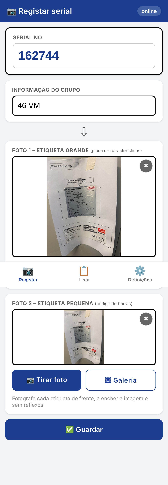
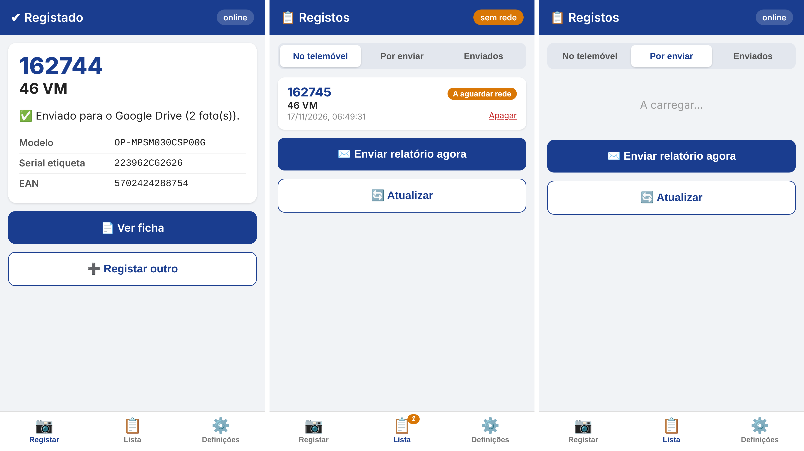

# 📷 Recolha de Serial Number – Máquinas

É uma aplicação para registo de serial number das máquinas grupos condensadores.

Aplicação para o telemóvel: regista o **serial**, o **grupo** e as **2 fotos das etiquetas**
(etiqueta grande e etiqueta pequena). O Google Apps Script cria um **PDF igual à folha em papel**,
com **QR code**, e envia-o por **email**.

 

## Funcionalidades
- Fotos com a câmara ou da galeria, reduzidas no telemóvel (envio rápido)
- **Funciona sem rede**: guarda no telemóvel e envia sozinho quando houver ligação
- Leitura automática da etiqueta (OCR): modelo, serial, EAN, voltagem…
- PDF com o layout da folha: SERIAL NO · INFORMAÇÃO DO GRUPO · Foto 1 · Foto 2 · QR code
- O QR abre uma ficha no telemóvel com os dados e as fotos
- Lista de registos (no telemóvel / por enviar / enviados) e botão "Enviar relatório agora"

## Estrutura
| Ficheiro | O que é |
|---|---|
| `index.html`, `sw.js`, `manifest.webmanifest`, `icons/` | A aplicação (publicada no GitHub Pages) |
| `apps-script/Codigo.gs`, `appsscript.json` | Servidor no Google Apps Script |
| `.github/workflows/servidor.yml` | Publica o servidor automaticamente |
| `apps-script/index.html` | Formulário alternativo dentro do Apps Script (ficheiro HTML `index`) |

## Instalação

### 1. Servidor – publicado automaticamente pelo GitHub
O código está em `apps-script/`. Sempre que muda, o GitHub Actions publica-o no Google Apps Script
(workflow **Publicar servidor**). Os dados privados ficam nos **Secrets** do GitHub, nunca no código.

**Configuração (uma vez):**
1. Ativar a **Google Apps Script API**: https://script.google.com/home/usersettings → *Ativado*.
2. Obter o login do `clasp` (ficheiro `.clasprc.json`) — num computador com Node.js:
   ```
   npx @google/clasp@2.4.2 login
   ```
   Autorizar no browser e abrir o ficheiro `~/.clasprc.json` (Windows: `C:\Users\<nome>\.clasprc.json`).
3. No GitHub: **Settings → Secrets and variables → Actions → New repository secret**:
   | Nome | Valor |
   |---|---|
   | `CLASPRC_JSON` | conteúdo completo do `.clasprc.json` |
   | `PASTA_ID` | ID da pasta do Drive (fim do URL da pasta) |
   | `EMAIL_DESTINO` | email(s) que recebem o relatório (`a@x.com,b@y.com`) |
   | `CODIGO_ACESSO` | PIN da aplicação |
4. **Actions → Publicar servidor → Run workflow.** No fim, o resumo mostra o `SCRIPT_ID`, o
   `DEPLOYMENT_ID` e o **URL do servidor**. Guardar `SCRIPT_ID` e `DEPLOYMENT_ID` também como Secrets
   (assim as próximas publicações atualizam o mesmo projeto e o URL não muda).
5. Abrir https://script.google.com → projeto **Recolha de Serial Number** → executar a função
   **`autorizar`** uma vez (autoriza Drive/Docs/Gmail e cria o envio diário às 18h).

<details><summary>Alternativa manual (sem GitHub Actions)</summary>

script.google.com → Novo projeto → colar `apps-script/Codigo.gs`, ficheiro HTML `index` e preencher o
`CONFIG`; Serviços (+) → Drive API; Implementar → Aplicação Web → Executar como **Eu** → Acesso
**Qualquer pessoa**.
</details>

### 2. Aplicação (GitHub Pages)
Settings → Pages → *Deploy from a branch* → escolher o ramo deste código e a pasta `/ (root)` → Save.
Em 1–2 minutos fica disponível em `https://<utilizador>.github.io/<repositório>/`.

### 3. Instalar no telemóvel
- **iPhone (Safari):** abrir o link → Partilhar ⬆️ → *Adicionar ao ecrã principal*
- **Android (Chrome):** abrir o link → menu ⋮ → *Instalar aplicação*
- Na 1.ª vez abre em **Definições**: colar o URL `/exec` e o PIN → *Guardar e testar ligação*

O URL e o PIN ficam guardados apenas no telemóvel — não estão no código.

## Atualizar a aplicação
Alterar os ficheiros e aumentar a versão em `sw.js` (`CACHE`) e em `index.html` (`VERSAO`).
